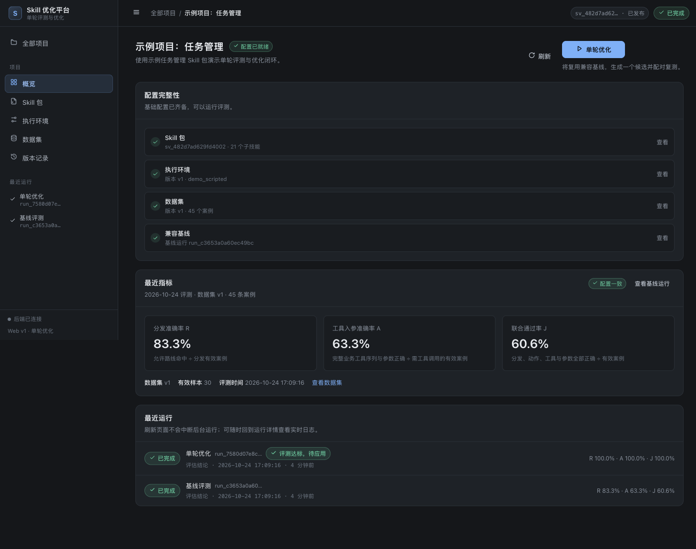

# Skill 优化平台（单轮评测与优化）

[](https://github.com/zishuo-xu/skill-optimization-platform/actions/workflows/ci.yml)

面向产品、前端、后端、Agent 工程及测试人员：导入 Skill 包（主 Skill + 21 个子技能），
固化执行环境与结构化测试集，先跑基线评测，再执行**一次点击一轮**的单轮优化：
定位错误 → 生成一个局部补丁 → 同条件复测 → 按冻结规则判定 → 人工应用/回滚/导出。

本仓库按根目录 `Skill优化平台需求文档_v1.docx` 实现，覆盖需求 §1–§54 与验收 A01–A20
（含运行记录 UX 增量）。**不训练/微调模型，不优化业务 Prompt，不做最终自然语言答案综合评分。**



---

## 1. 快速开始

```bash
git clone https://github.com/zishuo-xu/skill-optimization-platform
cd skill-optimization-platform
./start.sh
```

`start.sh` 会自动完成：**停止本平台旧服务** → 创建 `.venv` → 安装依赖 → 首次初始化示例项目
（导入 Skill 包、发布环境与数据集、跑基线 + 一次单轮优化）→ 启动服务并打开浏览器
（**http://127.0.0.1:8765**）。macOS 也可以直接双击 `start.command`。
重复执行会重新启动并加载最新代码，不会残留旧进程。

**Windows**（Windows 10/11 + Python 3.11+，安装时勾选 “Add python.exe to PATH”）：

```bat
start.bat
```

也可以直接双击 `start.bat`。参数与 `start.sh` 相同：
`--reset`、`--no-open`、`--seed-only`、`--no-kill`、`--port 8766`、`--host 0.0.0.0`、`--help`。
`start.bat` 默认也会先停止本仓库的旧服务（仅匹配本目录的 `python -m app.server`），
避免端口占用或旧代码残留；端口被其他程序占用时不会误杀，会给出提示。
`start.bat` 使用系统的 `py`/`python` 创建 `.venv`，首次需联网安装依赖；PowerShell 用于健康检查与自动打开浏览器。

常用参数：

```bash
./start.sh --reset       # 清空本地演示数据后重新初始化（会重新执行基线 + 单轮优化）
./start.sh --no-open     # 启动服务但不自动打开浏览器
./start.sh --seed-only   # 只初始化/重置示例数据（会先停止旧服务）
./start.sh --no-kill     # 不停止已运行的服务（已在运行时只打开浏览器）
./start.sh --port 8766   # 指定端口
./start.sh --help
```

也可以手动分步执行（用于 CI/生产）：

```bash
bash scripts/setup.sh
.venv/bin/python -m app.seed --with-optimize
./run.sh
```

### Skill 包格式

支持 ZIP 导入（「Skill 包」页 →「导入 ZIP」）。ZIP 根目录必须包含主 Skill 文件，
推荐结构：

```text
your-skill.zip
├── SKILL.md                  # 必需；大小写均可，导入后规范化为 SKILL.md
├── manifest.json             # 可选；缺省时自动生成
└── reference/                # 也可以是 references/
    ├── task_query.md         # 平铺子技能
    └── task_assign/
        └── SKILL.md          # 或按子技能目录嵌套
```

- **主文件**：根目录 `SKILL.md`（也兼容 `skill.md`）；ZIP 外面多套一层目录（如
  `my-skill/SKILL.md`）也可，导入时会自动去掉外层目录。
- **子技能**：`reference/` 或 `references/` 下的 `.md` 文件，支持再嵌套子目录；
  每个文件是一个子技能。
- **manifest.json 可选**。不提供时按 `reference(s)/` 自动生成映射：
  `skill_id` 取文件名（嵌套的 `xxx/SKILL.md` 取目录名），规范化为小写字母/数字/下划线；
  展示名取文件第一个 Markdown 标题，描述取第一段正文。中文或特殊文件名无法稳定生成
  `skill_id` 时会回退为 `skill_1`、`skill_2`。导入结果会返回 `manifest_generated` 警告，
  请在页面上核对子技能清单。
- **建议显式提供 manifest**（尤其是中文文件名、需要稳定 ID 或顺序时）：

```json
{
  "version": 1,
  "main": "SKILL.md",
  "subskills": [
    {"skill_id": "task_query", "name": "任务查询", "path": "reference/task_query.md",
     "description": "查询项目任务"},
    {"skill_id": "task_assign", "name": "任务指派", "path": "reference/task_assign/SKILL.md"}
  ]
}
```

- 文件 UTF-8 编码；拒绝路径穿越、绝对路径与符号链接；首期只允许改写已有 Markdown 文件，
  脚本和资源原样保存但不自动执行。
- 打包方式：把 `SKILL.md`、`reference/`（及可选 `manifest.json`）放在 ZIP 根目录即可；
  macOS/Linux 可在 Skill 目录内执行 `zip -r ../skill.zip .`，Windows 可在文件夹内全选后
  “发送到 → 压缩(zipped)文件夹”。浏览器直接选择文件夹上传的 UI 暂未提供，请使用 ZIP。

### 数据集格式

支持 `.jsonl`（推荐，每行一个案例）与 `.json`（数组，或 `{"cases":[...]}`），UTF-8。
**推荐用下面的简化写法**，只写你关心的“选中哪个子技能 + 调什么工具/参数”：

```json
{"query":"帮我修一修眼睛，让它更有神采","skill":"references/image-color-transfer-gallery.md","tool":{"functionName":"imageEditWorkflow","arguments":{"args":{"useOneWordFixPicture":"帮我修一修眼睛，让它更有神采"},"method":"imageOneWordFixPicture","request":{"query":"帮我修一修眼睛，让它更有神采"},"script":"scripts/ImageEditorAdaptor.ets"}},"mock":{"ok":true}}
```

简化字段：

| 写法 | 等价含义 |
| --- | --- |
| `skill` | 单个选中子技能；可写 manifest `skill_id`，也可直接写 `references/xxx.md` 路径（自动映射）；`skill_ordered` 多步路线写成 `["a","b"]` |
| `route` / `routes` | `routes` 可写平铺数组（一条路线）或二维数组（多条可选路线）；未写 `route_ordered` 时按集合比较 |
| `tool` / `tools` | 业务工具调用；可直接用 `functionName` 代替 `name`；`arguments` 原样比较 |
| `mock` / `mocks` | 自动生成该案例所有业务工具的模拟返回；`mock` 是统一响应，`mocks` 是 `{工具名: 响应}` |
| `action` | 省略时默认 `tool_call`；有 `missing` 时推断为 `clarify`；`no_action` 需显式写 |
| `missing` | 等价于 `missing_fields`（clarify 必填） |
| `id` / `group_id` / `split` / `tags` / `context` | 可选；`id` 缺省自动生成，`split` 缺省按 group 固定种子划分 |

- 不写 `fixtures` 时，会按 `expected.tool_calls` 自动生成通配模拟返回（未写 `mock` 时返回 `{"ok":true}`）。
  想故意测试缺模拟返回，请显式写 `"fixtures": []`。
- 也可以写 `fixtures` 映射：`{"tool_name": {"whatever":"response"}}`，或传统数组。
- 完整写法（`expected` + `fixtures` 数组）继续完全兼容，适合多路线、多工具、variants、严格比较规则等高级场景。

完整示例（高级/显式写法）：

```json
{"id":"case_001","query":"查询项目 P123 中进行中的任务","group_id":"g_status_query","split":"optimize","tags":["状态映射"],"expected":{"action":"tool_call","routes":[["task_query"]],"route_ordered":false,"call_match":"ordered_exact","tool_calls":[{"name":"list_tasks","arguments":{"project_id":"P123","status":"in_progress"}}],"missing_fields":[]},"fixtures":[{"name":"list_tasks","match":{},"response":{"tasks":[]},"consume":"always"}]}
```

- `clarify`：必须有 `missing_fields`，不能有业务 `tool_calls`；可带 routes 便于优化器归因
- `no_action`：不能有 routes / tool_calls / missing_fields
- `tool_calls` 是完整业务工具序列；内部工具 `select_skill/read_skill/finish` 不计分
- `routes` 必须对应当前 Skill 包 manifest；导入前先发布 Skill 与执行环境
- `fixtures` 未命中记 `fixture_miss`，不会访问真实服务
- `split` 缺省按 `group_id` 固定种子划分（默认 70/20/10；<10 条时退化）
- 重复 `case_id` 会阻止发布；重复 query 仅警告；无效应修复或在导入时明确剔除

打开页面左侧的示例项目「示例项目：任务管理」，进入「运行详情」查看基线与优化运行。

**测试：**

```bash
.venv/bin/python -m pytest -q        # 226 passed
```

### 文档导航

| 文档 | 内容 |
| --- | --- |
| [docs/ARCHITECTURE.md](docs/ARCHITECTURE.md) | 组件边界、数据模型、状态机、事件模型、可靠性、设计取舍 |
| [docs/API.md](docs/API.md) | `/api/v3` REST/SSE 接口、示例请求、错误与状态码 |
| [docs/DEPLOYMENT.md](docs/DEPLOYMENT.md) | 安装、配置、数据备份、反向代理/SSE、生产加固、故障排查 |
| [docs/DEMO.md](docs/DEMO.md) | 演示数据、预期结果、界面验证步骤（含截图） |
| [docs/CONTRACTS.md](docs/CONTRACTS.md) | 模块/数据结构/API/事件契约（开发基线） |
| [docs/VERIFICATION.md](docs/VERIFICATION.md) | A01–A20 自动化验收与界面联调记录 |
| [docs/REQUIREMENTS_TRACEABILITY.md](docs/REQUIREMENTS_TRACEABILITY.md) | 需求 §1–§54 追溯与差异说明 |
| [app/samples/README.md](app/samples/README.md) | 示例 Skill 包、数据集与刻意保留的缺陷 |

更多文档索引见 [docs/README.md](docs/README.md)。

---

## 2. 演示结果（确定性示例环境）

示例数据 45 条（33 优化集 / 8 验证集 / 4 最终测试集），示例环境使用确定性
`demo_scripted` 模型适配器与冻结启发式优化器，保证离线可重复。实际运行结果：

| 指标 | 基线（优化集） | 候选（优化集） | 基线（验证集，3 次配对） | 候选（验证集） |
| --- | --- | --- | --- | --- |
| 分发准确率 R | 83.33%（25/30） | **100%**（30/30） | 57.1%（12/21） | **100%** |
| 工具入参准确率 A | 63.33%（19/30） | **100%**（30/30） | 42.9%（9/21） | **100%** |
| 联合通过率 J | 60.61%（20/33） | **100%**（33/33） | 37.5%（9/24） | **100%** |

接受规则 `accept-v1` 逐项判定通过 → `decision=accept`（“评测达标，待应用”），
用户点击「应用候选」后当前版本指针更新；应用前校验项目当前版本仍等于本轮基线，
不一致返回 `409`，不会自动覆盖。

> 示例环境的优化器未接真实模型：运行记录会明确先记录 `optimizer_not_configured` /
> `fallback_started`，再使用冻结启发式回退生成补丁，**不会伪造模型输出或伪造成功**。
> 接入真实优化模型后走同一事件与判定链路（见 §8）。

---

## 3. 功能范围

| 模块 | 实现 |
| --- | --- |
| 项目 | 列表/新建/归档/概览/版本记录；配置完整性与主按钮随状态变化 |
| Skill 包 | ZIP 或文件夹 JSON 导入、SKILL.md + manifest 校验、21 子技能映射、缺失入口/重复 ID/失效引用/编码错误/路径穿越/绝对路径/符号链接检查、草稿编辑、发布不可变版本、导出还原 |
| 执行环境 | 业务 Prompt 模板、业务模型与优化模型独立配置（API / Python 流程 / 企业网关 WebSocket）、工具协议、上下文加载、运行参数、预算；发布版本只读，修改生成草稿；变更生成新版本并冻结指标 |
| 数据集 | JSONL/JSON 导入预检（总数/有效数/错误行号与原因）、稳定 case_id、按 group_id 固定种子划分、覆盖统计、重复 query 警告、发布后不可原地修改、导出同结构 |
| 评测 | 确定性评分器 R/A/J 独立计分、集合/有序路线、`ordered_exact`/`unordered` 调用、严格 JSON 深度比较、Schema 先校验、clarify/no_action、诊断分类与字段路径 |
| 单轮优化 | 预检 → 基线评测（兼容缓存复用）→ 错误分析（仅优化集）→ 单候选生成 → 静态检查 → 复测 + 3 次配对验证 → 冻结规则判定；候选不覆盖当前版本 |
| 版本与应用 | 父版本/来源运行/指标/文件差异；应用、冲突校验、回滚（指针切回历史版本）、ZIP 导出与报告 JSON/CSV |
| 实时运行记录 | 事件持久化 + SSE 回放/续接、问题摘要与定位、筛选、展开详情、按需加载大内容、断线重连、终态历史回放（需求 §44–§54） |
| Python/网关接入 | OpenAI 兼容 HTTP、企业网关 WebSocket（SSE 式事件聚合、分片工具参数、尾部 usage、重试/中断语义）、用户 Python 流程级 `run_case`、纯文本路由解析与 `result_source` 标注 |

首期明确不做：多候选搜索、多轮自动迭代、优化器自我改进、多人权限、真实生产工具执行侧效应。

---

## 4. 架构

```
Browser（原生 ES Modules SPA，无构建）
        │  /api/v3（REST + SSE）
Starlette API（app/api_v3.py）
        │
SQLite 元数据 + 数据目录（不可变包、trace artifacts、导出）
        │
Worker 线程（租约 + 心跳）── app/single_round.py
        ├── 执行器 app/execution.py ← 模型适配层 app/adapters/*（demo_scripted / openai_http / enterprise_ws / flow）
        ├── 评分器 app/evaluation.py（纯函数）
        ├── 工具模拟 app/fixtures.py / obs_tools.py
        ├── 优化器 app/optimizer.py + 补丁静态检查 app/patch.py
        └── 接受规则 app/acceptance.py（accept-v1，运行前冻结）
```

关键设计：

- **执行环境冻结**：`EnvironmentVersion` 保存 Prompt、模型/优化器配置、工具协议、加载策略、
  预算、评分器与接受规则及哈希；运行快照记录 Skill/环境/数据/评分器/重复次数指纹。
  基线缓存只在指纹完全一致时复用，否则重跑并说明原因。
- **权限隔离**：业务执行器只收到 query、允许的上下文、Skill 内容、工具定义与模拟返回，
  **永远不接收 expected/评分标签**；优化器只读优化集失败证据，不读取验证集/最终测试集样本内容。
- **真实执行**：评分、复测、候选生成、静态检查、应用与回滚都走真实代码路径；
  示例模型只是统一的适配器实现，不是硬编码评分。
- **事件可观测**：每个阶段/案例/模型调用/工具/评分/优化器回退都有持久化事件（严格递增
  `seq`），先落盘再发布；大内容存 `trace_artifacts`，事件只引用 ID。

---

## 5. 单轮流水线（`app/single_round.py`）

| 阶段 | 内容 | 产物 |
| --- | --- | --- |
| preflight | 文件完整性、工具协议、数据划分、预算、fixture 覆盖 | 预检事件与运行快照 |
| baseline_eval | 优化集基线；兼容缓存则复用，否则新跑 | 轨迹、基线指标 |
| error_analysis | 仅优化集失败案例与诊断聚合 | 归因证据 |
| candidate_generation | 模型/启发式生成一个补丁；失败时先记录直接原因再回退 | 候选定义 |
| static_check | 白名单、唯一命中、manifest、结构、禁止答案/case_id 硬编码 | 检查结果 |
| retest | 候选跑优化集；基线/候选各 3 次配对验证 | 逐案例对照 |
| decision | `accept / reject / inconclusive` + 规则明细 | 决策记录与报告 |

状态机：`queued → running → cancel_requested → completed | failed | cancelled`；
`completed` 携带 decision，`accept` 只表示符合门槛，**不表示已应用**。

---

## 6. 评分口径（`score-v1`）

- **R 分发准确率**：实际子技能路线匹配任一允许路线的有效案例 ÷ 分发有效案例；
  集合模式去重比较，`route_ordered=true` 时严格顺序且额外调用算错。
- **A 工具入参准确率**：完整业务工具序列的工具名、数量、顺序与全部参数均正确的案例 ÷
  预期需要业务工具的有效案例；分发错误不影响 A（A05 独立计分）。
- **J 联合通过率**：分发、动作、工具与参数全部正确的案例 ÷ 全部有效案例；
  clarify（action + missing_fields 集合）与 no_action 也计入。
- 基础设施错误（认证/网络/超时/限流等）不计入分母、单独报告并阻止自动晋级；
  能力失败（格式错误、拒答、步数耗尽、超限、fixture_miss 等）计入分母。
- 参数比较默认严格 JSON 深度比较（键序无关、类型严格、缺失≠null、数组顺序敏感、
  额外参数判错）；放宽规则必须由 `expected.compare` 显式声明版本化规则。
- 分母为 0 显示“未评估”，不能当作满分；验证集核心指标缺有效案例不得晋级。

接受规则 `accept-v1`：R、A 均不下降，至少一项严格提高，J 不下降；critical 案例不得
从通过变失败；不得存在基础设施或包完整性错误；全部持平拒绝；预算不足或验证不完整
判为 `inconclusive`。阈值在运行启动时冻结，不因当前候选临时调低。

---

## 7. 运行记录 UX（需求 §44–§54）

- 顶部问题摘要仅在影响运行时显示：失败位置、直接原因、影响范围、后续处理；
  多个问题可逐项定位；定位会自动清除遮挡筛选、展开并聚焦目标记录。
- 筛选：全部记录 / 错误与警告、案例范围、优化器事件开关。
- 时间日志：时间、状态图标、步骤标题、上下文（case_id / 阶段 / 基线候选 / 重复序号）、
  展开箭头；可同时展开多条，默认折叠；详情依次给出原因与影响，再按需加载
  「请求与 messages」「原始返回」「评分差异」「技术详情」。
- 跟随：滚动到底自动跟随；向上阅读暂停并显示“有 N 条新记录 / 回到最新”。
- 实时：SSE `id: seq` 支持 `Last-Event-ID` 与 `after_seq` 续接；前端按
  `run_id + seq` 去重、断线补缺口并显示“实时连接中断，正在重连”；终态后仍可回放历史。
- 优化器异常绝不静默：调用失败 / 空输出 / JSON 解析失败 / 未配置 / 主动无修改分别记录
  `optimizer_call_failed`、`optimizer_empty_response`、`optimizer_parse_failed`、
  `optimizer_not_configured`、`optimizer_no_change`，回退再记录
  `fallback_started` / `fallback_no_change`；`no_patch` 只是最终结果。
- 凭据写入前脱敏，默认不保存原始网关帧；导出仅由用户主动触发。

---

## 8. 接入真实模型 / 企业网关

在「执行环境」中选择业务模型适配器并发布新环境版本：

- `openai_http`：标准 Chat Completions HTTP；`base_url`、模型标识、超时/重试。
- `enterprise_ws`：企业网关 WebSocket。保留 `api_key`/`user`/`extra_body` 等字段原样发送，
  不自动改写 `Authorization`；WS 帧还原为 SSE 式事件，支持跨帧拆分/单帧多事件、
  content 与 tool_calls（按 choice/tool index）聚合、尾部 usage、`[DONE]`；
  连接/首包/空闲/总超时与心跳可配；中断标记 `stream_interrupted` 且不跨连接拼接。
- `flow`：用户已有 Python 流程负责分发与执行，平台调用 `run_case` 接收规范化结果；
  必须返回真实观测到的路线与工具参数，仅能分发时 A 显示“未评估”。
- 优化模型在「优化模型」中单独配置；未配置时按 §49 记录原因并使用启发式回退。

适配器必须固定在环境版本中（代码入口、依赖锁定、Python 版本、请求模板、流解析器、
输出解析器哈希），运行中不可修改。供应商无法固定快照时，报告中标注可复现性限制。

---

## 9. 接口与数据

REST + SSE，前缀 `/api/v3`，完整列表与载荷见 [`docs/CONTRACTS.md`](docs/CONTRACTS.md)。
核心接口：

- `POST /projects`、`POST /projects/{id}/skill-versions`、`POST /projects/{id}/environments`、
  `POST /projects/{id}/datasets`（含 `/datasets/preflight`）
- `POST /runs`（`mode=baseline|optimize|final_test`，`Idempotency-Key`，202 立即返回）
- `GET /runs/{id}`、`GET /runs/{id}/events`（SSE）、`/event-history`、`/cases`、`/diff`、`/issues`
- `POST /runs/{id}/cancel`、`POST /runs/{id}/apply`（`expected_current_version`，冲突 409）
- `GET /runs/{id}/report.json|.csv`、`GET /skill-versions/{id}/export`

数据实体：Project / SkillVersion / EnvironmentVersion / DatasetVersion+Case / Run /
CaseResult / Event / TraceArtifact / Candidate / Decision / AuditLog，全部带版本与哈希。
SQLite 元数据 + 磁盘不可变包；事件单运行严格递增、先持久化后发布。

---

## 10. 测试与验收映射

```bash
.venv/bin/python -m pytest -q
```

| 验收 | 用例 |
| --- | --- |
| A01 Skill 导入/映射/坏引用/路径穿越/导出还原/草稿发布 | `tests/test_a01_skill_package.py` |
| A02 Prompt 发布只读、环境新版本、缓存失效 | `tests/test_a02_environment.py` |
| A03 数据导入校验与分组划分、执行器拿不到 expected | `tests/test_a03_dataset.py`、`test_a20_security.py` |
| A04 漏选/多选/错序/错工具/缺参/类型/额外参计分 | `tests/test_a04_scoring.py` |
| A05 R/A 独立计分与联合结果 | `tests/test_a04_scoring.py`、`test_a05_metrics.py` |
| A06 真实单轮优化/补丁/前后报告/失败可拒绝 | `tests/test_a06_optimizer.py`、仓库演示 |
| A07 指标下降/critical/验证不完整 → 拒绝或证据不足 | `tests/test_a07_acceptance.py` |
| A08 刷新/重连/取消/Worker 重启/幂等 | `tests/test_a08_run_lifecycle.py` |
| A09 应用更新当前版本、并发冲突、回滚、导出 | `tests/test_a09_apply_rollback.py` |
| A10 澄清/无工具/fixture_miss/认证失败/预算耗尽 | `tests/test_a10_runtime_edges.py` |
| A11 真实 WebSocket 网关、messages 不含答案 | `tests/test_a11_ws_gateway.py` |
| A12 拆分/合并事件、空 delta、尾部 usage、中断、分片参数 | `tests/test_a12_stream_assembly.py` |
| A13 仅分发能力时 A 未评估 | `tests/test_a13_capabilities.py` |
| A14 取消/超时/重试不重复计分、适配器变更使缓存失效 | `tests/test_a14_cache.py`、`test_a13_capabilities.py` |
| A15–A18 运行记录定位/筛选/并发不串线/刷新续接 | 前端 `web/js/views/runLog.js`，人工联调记录见 [docs/VERIFICATION.md](docs/VERIFICATION.md) |
| A19–A20 取消重启、脱敏 | `tests/test_a19_cancel_restart.py`、`test_a20_security.py` |

---

## 11. 配置

| 环境变量 | 默认 | 说明 |
| --- | --- | --- |
| `SKILLOPT_DATA_DIR` | `./data` | 数据目录（SQLite、Skill 包、trace、导出） |
| `SKILLOPT_DB_PATH` | `<data>/app.db` | 数据库路径 |
| `SKILLOPT_HOST` / `SKILLOPT_PORT` | `127.0.0.1` / `8765` | Web 服务地址 |
| `SKILLOPT_DISABLE_WORKER` | 空 | `1` 时不启动后台 Worker（测试用） |
| `SKILLOPT_PRICE_INPUT_1K` / `_OUTPUT_1K` | `0` | Token 单价（配置后报告显示费用） |
| `SKILLOPT_LOG_LEVEL` | `INFO` | 日志级别 |

凭据以服务端引用保存（环境配置中的 `api_key_ref` 等），不会进入 Prompt、日志或导出；
API 返回环境配置时对凭据类字段脱敏；`api_key` 等字段不会被自动改成标准鉴权头。

---

## 12. 目录结构

```
app/
  api_v3.py          HTTP API（REST + SSE 回放）
  single_round.py    单轮流水线（阶段/取消/预算/决策）
  execution.py       案例执行循环（内部工具、fixtures、消息构造）
  evaluation.py      确定性评分器（R/A/J + 诊断）
  dataset.py         数据导入/校验/划分/覆盖
  optimizer.py       优化器协议、解析、启发式回退、事件顺序
  patch.py           补丁应用、静态检查、统一 diff
  acceptance.py      accept-v1 冻结规则
  persistence.py     SQLite 仓储（版本/运行/结果/事件/审计）
  worker.py          租约 + 心跳后台执行器
  adapters/          demo_scripted / openai_http / enterprise_ws / flow / 流事件
  obs_tools.py       select_skill / read_skill / finish 协议
  samples/           示例 Skill 包、工具协议、Prompt、数据集、环境
  seed.py            演示项目初始化
start.sh             一键启动（macOS/Linux；自动装依赖/初始化示例/启动/打开浏览器）
start.command        macOS 双击启动入口
start.bat            Windows 一键启动（双击或 cmd 运行）
web/                 原生 ES Modules 深色中文 SPA（无构建）
tests/               A01–A20 自动化验收
docs/CONTRACTS.md    模块/API/事件契约
scripts/             环境安装与示例资产生成脚本
```

---

## 13. 边界与后续

- 本仓库为**单用户本地部署**（SQLite + 进程内 Worker），持久化任务与租约恢复已实现；
  多实例部署需替换为共享数据库与分布式任务队列。
- `demo_scripted` 是确定性模拟器，仅用于离线演示与测试；真实效果需接入企业网关模型，
  不同适配器成绩不可混用。
- 按需求首期范围，未实现多候选搜索、多轮自动迭代、优化器自我改进、多人权限与真实
  生产工具执行；这些为后续扩展方向。
- 供应商无法固定快照时，以报告中的可复现性标注为准；最终测试集只应在阶段验收时运行，
  一旦用于后续优化应转为开发数据并补充新的留出集。
