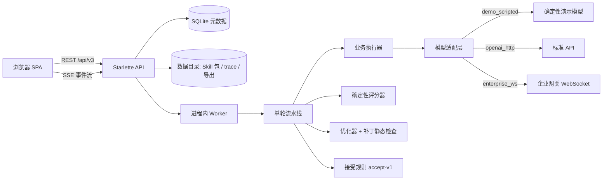
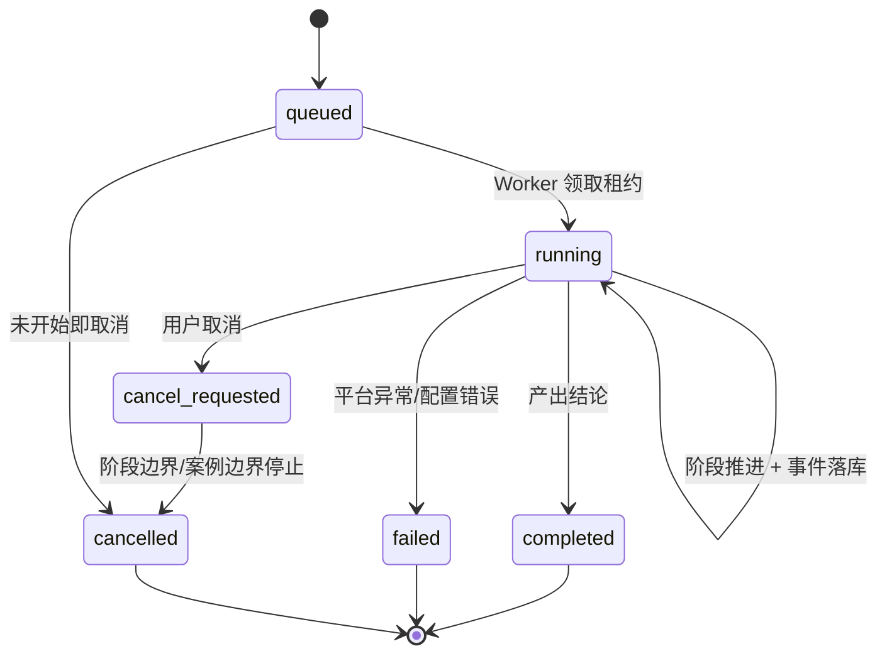
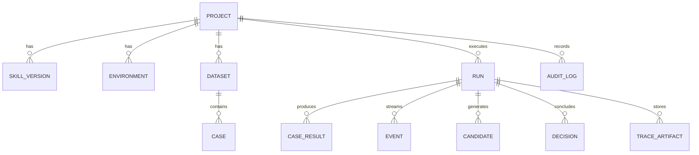

# 架构设计

本文描述 Skill 单轮优化平台的组件边界、数据模型、运行状态机、事件模型与关键设计取舍。
接口细节见 [API.md](API.md)，部署与运维见 [DEPLOYMENT.md](DEPLOYMENT.md)，
模块级契约见 [CONTRACTS.md](CONTRACTS.md)。

## 1. 目标与非目标

**目标**

- 导入 Skill 包（主 Skill + references 子技能），固定执行环境、数据集、评分器与重复次数后，
  先跑基线，再执行一次点击一轮的优化：定位错误 → 生成一个局部补丁 → 静态检查 →
  同条件复测 → 按运行前冻结的规则判定 → 人工应用/回滚/导出。
- 所有评分、复测、候选生成、版本变更都走真实代码路径；不得用静态页面或硬编码分数代替执行。
- 运行可观测：每个阶段/案例/模型调用/工具/评分/优化器回退都有持久化事件，支持刷新、
  断线续接、取消、Worker 重启后的状态恢复。

**非目标（首期范围外）**

- 不训练/微调业务模型、不优化业务系统 Prompt、不对最终自然语言答案做综合评分。
- 不实现多候选搜索、多轮自动迭代、优化器自我改进、多人权限、真实生产工具执行。

## 2. 系统上下文

- 前端：原生 ES Modules SPA，无构建步骤，由后端 `/` 静态托管；仅 `?mock=1` 时加载内存假后端。
- API：Starlette，同步业务逻辑 + SSE 流；不依赖 pydantic（避免原生扩展签名问题）。
- Worker：进程内线程，通过数据库租约 + 心跳领取任务；任务持久化在 `runs` 表。
- 存储：SQLite 保存元数据与事件；不可变 Skill 包、trace 资源、导出文件保存在磁盘。
- 企业 HTTP 网关复用 `openai_http`，支持完整请求地址、Body 扩展与 Headers；响应仍需兼容 Chat Completions/SSE，特殊协议在适配层调整。见 [接入说明](HTTP_GATEWAY_INTEGRATION.md)。

## 3. 组件职责

| 模块 | 职责 |
| --- | --- |
| `app/api_v3.py` | HTTP/SSE 路由、入参校验、错误映射、资源下载 |
| `app/services.py` | 应用服务：项目详情/概览、版本导入发布、数据集预检、运行创建/视图、应用候选、报告 |
| `app/single_round.py` | 单轮流水线：预检、基线、错误分析、候选生成、静态检查、复测、决策；取消与预算 |
| `app/execution.py` | 单案例执行循环：固定消息构造、内部工具、业务工具 + fixture、步数/超时/取消 |
| `app/adapters/*` | `ModelAdapter` 接口与 demo/HTTP/WS 适配器、WS 分帧与事件聚合、文本协议解析 |
| `app/obs_tools.py` | `select_skill` / `read_skill` / `finish` 协议与路由事件 |
| `app/evaluation.py` | `score-v1` 确定性评分：R/A/J、诊断分类、指标聚合 |
| `app/dataset.py` | JSONL/JSON 导入、校验、稳定 ID、分 group 划分、覆盖统计 |
| `app/fixtures.py` | 模拟工具返回匹配（按名 + 参数子集、once 按序消费） |
| `app/optimizer.py` | 优化器输入/输出契约、输出解析、启发式回退、事件顺序 |
| `app/patch.py` | 补丁应用（仅已有 Markdown、唯一命中、原子）、静态检查、统一 diff |
| `app/acceptance.py` | `accept-v1` 冻结规则 |
| `app/persistence.py` | 仓储：版本、运行、结果、事件、候选、决策、审计、完整性校验 |
| `app/run_events.py` | 运行事件写入 + `stage_progress` 同步 |
| `app/worker.py` | 租约领取、心跳、崩溃恢复、顺序执行 |
| `app/seed.py` | 演示项目初始化（真实导入/发布/执行基线/可选优化） |
| `app/skill_package.py` | ZIP/JSON 包安全解析、manifest 校验、导出打包 |
| `app/reports.py` | 评测报告 JSON/CSV 数据组装与脱敏 |
| `web/*` | 深色中文 SPA：项目、Skill、环境、数据集、运行详情四标签页、运行记录 |

## 4. 端到端流程

### 4.1 配置阶段

1. 创建项目。
2. 导入 Skill ZIP（或文件夹 JSON）→ 安全检查 → manifest 校验 → 发布不可变 `SkillVersion`。
3. 创建执行环境：业务 Prompt、业务模型、优化模型、加载策略、运行参数、预算、
   评分器与接受规则 → 发布 `EnvironmentVersion`（哈希冻结）。
4. 导入数据集 JSONL/JSON → 预检（行号/错误/字段路径）→ 按 group 固定种子划分 →
   发布 `DatasetVersion`（不可原地修改）。
5. 修订数据集时复制已发布版本为草稿，逐案例保存并更新 hash/校验报告；发布前完整校验，
   同一事务核对草稿 hash 与项目当前数据集指针。草稿不用于运行，发布后旧运行仍引用原版本，新版本需重跑基线。

环境页的连接测试与评测运行独立：复用正式 HTTP/WS 适配器发送一次自定义输入短请求，
不调用业务工具，不创建运行或保存配置；同步探测在 threadpool 执行。详情见 [连接测试](CONNECTION_TEST.md)。

### 4.2 运行阶段（`single_round.py`）

`optimize` 运行的阶段：

1. `preflight`：Skill 完整性、数据划分、预算、fixture 覆盖（按本次运行涉及划分）。
2. `baseline_eval`：优化集基线；若存在指纹完全一致的 completed 基线则复制结果复用，否则新跑。
3. `error_analysis`：只聚合优化集失败案例（含 expected、实际结果、评分诊断、可观察事件）。
4. `candidate_generation`：优化模型或冻结启发式生成**一个**补丁；失败时先记录直接原因，
   再进入回退；事件顺序完整可审计。
5. `static_check`：补丁应用到隔离副本 → 白名单/唯一命中/manifest/结构/禁止答案与 case_id
   硬编码等检查 → 通过后创建不可变候选 Skill 版本（`status=candidate`，不改变当前指针）。
6. `retest`：候选跑优化集；基线与候选各跑 3 次配对验证（同一环境、数据集、评分器与种子）。
7. `decision`：`accept-v1` 逐项判定，写入 `decisions` 与 `decision_made` 事件。

基线运行只执行 `baseline_eval`；最终测试运行只执行 `final_test`，不参与候选选择。

## 5. 数据模型

关键表（完整定义见 `app/db.py`）：

| 表 | 说明 |
| --- | --- |
| `projects` | 当前 Skill/环境/数据集指针（指针切换只影响平台，不修改外部目录） |
| `skill_versions` | 不可变包版本：manifest、文件哈希、content_hash、父版本、来源运行、status |
| `environments` | Prompt、模型/优化器配置、加载/运行/预算/评分器/接受规则、hash |
| `datasets` / `cases` | 数据版本与案例（expected/fixtures/split/group/tags/validation） |
| `runs` | 运行快照、指纹、状态/阶段/进度、预算、决策、租约与心跳、指标/成本 |
| `case_results` | 每轮 × 阶段 × 案例 × 变体 × 重复序号唯一；actual/scores/error/usage |
| `events` | 单运行严格递增 `seq`；stage/case/split/variant/repeat/attempt/call_id/type/level/payload |
| `trace_artifacts` | 大请求/响应/原始输出，事件只存 artifact id 引用 |
| `candidates` / `decisions` | 候选补丁、诊断、检查；判定依据、应用时间 |
| `audit_log` | 导入/发布/应用/回滚等人工操作记录 |

事件写入使用事务分配 `seq`，先落盘再通过 SSE 发布；单运行只有一个写入者（Worker 租约保证）。

模型完成事件保存脱敏正文与工具调用，大响应转存 `trace_artifacts` 后按需读取。
输出接口区分逐次调用记录与历史案例结果；不会用案例结果补造原始回复。见 [模型输出说明](MODEL_OUTPUT_VISIBILITY.md)。

## 6. 评分与接受

- R/A/J 的计算口径、严格 JSON 比较、clarify/no_action、infra 与能力失败的区别见
  [README §6](../README.md#6-评分口径score-v1)。
- 基线缓存指纹 = Skill 版本 + 环境版本 + 数据版本 + 评分器版本 + 基础重复次数；
  任一变化即缓存失效并重新评测，概览会说明不可复用原因。
- `accept-v1`：R/A 不降、至少一项严格升、J 不降、critical 不回归、无基础设施/包完整性错误；
  全部持平拒绝；预算不足或验证不完整判 `inconclusive`；阈值在运行启动时冻结。

## 7. 隔离与安全边界

- **执行器隔离**：业务 Agent 只收到 query、允许的上下文、Skill 内容、工具定义与模拟返回；
  永远不接收 expected/评分标签。大内容通过 trace artifact 存证。
- **优化器隔离**：只读优化集失败证据与 expected；过滤 validation/final_test 样本内容与答案。
- **候补约束**：只允许修改已有 `.md` 文件；禁止新增/删除文件与修改 manifest/脚本；
  静态检查扫描 case_id 与答案硬编码；候选不覆盖当前版本，应用时校验基线指针。
- **凭据**：环境配置保存服务端引用；API 返回配置时脱敏（`*_ref` 除外）；
  报告/导出/事件默认不含凭据；网关帧默认不落盘。
- **工具模拟**：fixtures 未命中立即 `fixture_miss`，不访问真实业务服务；无真实写副作用。

## 8. 可靠性

| 机制 | 实现 |
| --- | --- |
| 任务持久化 | `runs` 表状态机；刷新页面不依赖进程内状态 |
| 租约与心跳 | Worker 领取写入 `lease_owner/lease_expires_at` 并定期续租 |
| 崩溃恢复 | 启动时回收过期租约回 `queued`，重跑未完成阶段；已完成案例结果按唯一键去重保留 |
| 取消 | `cancel_requested` + 阶段/案例/模型调用边界检查；停止派发，在途尽力中断 |
| 预算 | 启动前冻结 Token/金额/时长；派发前检查，耗尽停止并记录 `budget_exceeded` |
| 事件回放 | `GET /event-history?after_seq=` + SSE `Last-Event-ID`/`after_seq`，按 `run_id+seq` 去重 |
| 幂等启动 | `Idempotency-Key` + `(project_id, idempotency_key)` 唯一索引 |
| 并发案例 | 每轮环境并发配置（默认 3），结果唯一键防重复；事件写入串行化 |

## 9. 关键取舍

1. **SQLite + 进程内 Worker**：单用户本地部署足够、零外部依赖；多实例部署需替换共享数据库
   与分布式队列（接口已按任务持久化设计）。
2. **无构建前端**：降低部署成本与供应链依赖；视图按模块拆分，便于维护。
3. **严格 JSON 比较**：默认不做“猜测式等价”（类型、缺失/null、数组顺序、额外参数都严格）；
   放宽规则必须由数据集显式声明版本化 `compare` 规则。
4. **演示适配器显式标注**：`demo_scripted` 是确定性规则模拟器，仅用于离线演示与测试；
   报告中会标注可复现性限制，不同适配器成绩不可混用。
5. **事件先落盘再发布**：运行日志可回放、可定位、可断线续接；大内容外置避免事件表膨胀。
