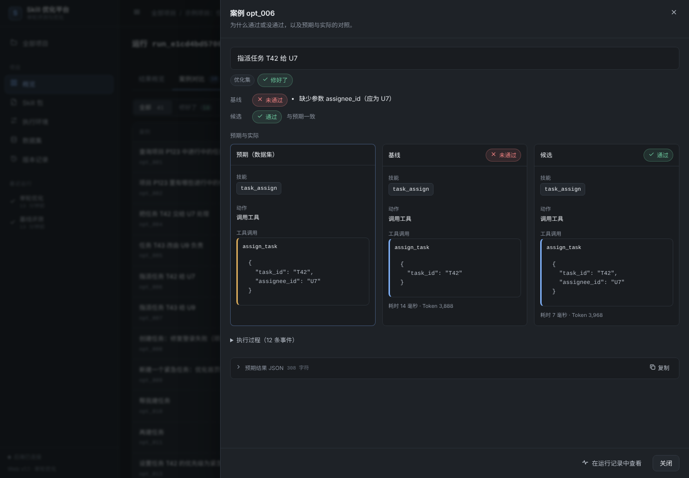

# 演示与验收路径

## 1. 准备

以下重置命令仅用于可清空的演示数据；已有项目直接运行 `./start.sh`，不要带 `--reset`。

```bash
./start.sh --reset           # macOS/Linux：一键安装 + 重置示例 + 启动并打开浏览器
# 或分步：
bash scripts/setup.sh
.venv/bin/python -m app.seed --reset --with-optimize
./run.sh                     # http://127.0.0.1:8765
```

Windows 10/11 在安装 Python 3.11+ 后，双击 `start.bat`，或在 cmd 执行：

```bat
start.bat --reset
```

`seed --with-optimize` 会为**两个示例项目**真实执行完整闭环：

- 「示例项目：任务管理」：21 子技能 Skill 包 + 45 条数据集
- 「示例项目：修图」：12 类语流参数子技能 + 62 条数据集（24 优化 / 21 验证 / 17 最终测试）

两者都会导入 Skill 包、发布环境和数据集并跑基线。任务管理示例演示缺陷修复与候选接受；
修图标准包不植入缺陷，完整基线已经通过时单轮优化可因无有效候选而拒绝。

## 2. 预期结果

| 指标 | 基线（优化集） | 候选（优化集） | 基线（验证集×3） | 候选（验证集×3） |
| --- | --- | --- | --- | --- |
| 分发准确率 R | 83.33%（25/30） | **100%（30/30）** | 57.1%（12/21） | **100%（21/21）** |
| 工具入参准确率 A | 63.33%（19/30） | **100%（30/30）** | 42.9%（9/21） | **100%（21/21）** |
| 联合通过率 J | 60.61%（20/33） | **100%（33/33）** | 37.5%（9/24） | **100%（24/24）** |

候选改动 5 个文件、9 处局部修改，静态检查通过，`decision=accept`（“评测达标，待应用”）。

### 2.1 修图示例项目（主技能路由，子技能定义参数）

- 12 类功能：一句话修图、换色、去背景、增强、裁剪、旋转/镜像、尺寸、色调、滤镜、人像、移物、替换背景。
- 主 `SKILL.md` 处理口语、改口、否定、专用技能优先和最多三步有序任务；只按需加载 reference。
- 业务选择输出 `path + skillName`；工具输出 `functionName + skillName + arguments`。
- 每个 reference 定义 method、字段含义、类型/范围、枚举、默认、澄清及完整调用示例。
- 数据集完整比较 method、固定 script、原始 request.query 和 args，不只比较 args 子树。
- 标准包不再故意缺参数或包含错误颜色映射。任务管理示例仍保留显式的优化练习。
- fixtures 模拟业务工具返回；新增 method 是示例协议，不代表真实 SDK 或图片效果已经验证。

已有项目可不清空历史直接更新：

```bash
.venv/bin/python -m app.seed --refresh-image
```

该命令保留既有业务模型、优化模型、预算、旧 Skill/环境/数据集与运行，发布并切换三项新版本；
不发起模型调用。新环境与旧基线不兼容，需要重新评测。设计见 [IMAGE_SKILL_EXPANSION.md](IMAGE_SKILL_EXPANSION.md)。

## 3. 界面验证步骤

### 3.1 概览


1. 打开项目列表 → 「示例项目：任务管理」或「示例项目：修图」。
2. 核对「配置完整性」四项（Skill 包/执行环境/数据集/兼容基线）与「最近指标」
   R 83.3%、A 63.3%、J 60.6%。
3. 主按钮为「单轮优化」；点击后侧栏展示版本快照、复用基线、候选 1、验证 3 次、
   预算与接受条件。

### 3.2 运行结果


1. 打开「最近运行」中的单轮优化（或基线运行）。「结果概览」从上到下只有三块：
   - **结论**：一句话说明结果（如「候选更好，建议应用」「候选没有变好，不建议应用」「33 个案例中 13 个没通过」），
     下面是三个指标「选对技能 R / 参数正确 A / 整体通过 J」的当前值与原来的值，以及下一步按钮（应用候选、看失败案例等）。
     单轮优化的指标按验证集统计（结论就按这一组判定），基线运行按全部案例统计。
   - **案例结果**：修好了 / 变差了 / 仍然失败 / 一直通过（基线运行为 没通过 / 通过）的数量，点数字直接打开对应案例；
     下方「主要原因」按每个案例最主要的一条失败原因归类计数。
   - **改了什么**：优化器的一句话诊断和改动的文件，细节在「文件差异」。
   完整指标表（优化集 / 验证集）、逐项判定规则、执行与成本收在底部「更多」里。
2. **定位失败案例**：在「案例对比」用顶部筛选（全部 / 修好了 / 变差了 / 仍然失败 / 一直通过）切换；
   每行一个案例，右侧「原因」直接写出没通过的原因，如「缺少参数 assignee_id（应为 U7）」
   「参数 priority 不对：给了 urgent，应为 high」「应该请求澄清，实际调用工具」。修好的案例显示原来的原因。
3. 点击案例打开详情：

   

   - 顶部逐侧列出基线 / 候选是否通过，没通过时列出全部原因；
   - 「预期与实际」三列并排：预期（数据集）、基线、候选，各列都是技能、动作、工具调用与完整参数；
   - 使用语义比较时另有「评分模型判定」；执行过程事件默认收起。
4. 「文件差异」：变更文件与统一 diff，附诊断/假设/风险与关联案例。
5. 应用：结论为「候选更好，建议应用」时点击「应用候选」→ 确认父版本/变更文件数 →
   应用后项目当前版本指针切换（旧版本保留，可回滚）。

### 3.3 运行记录


1. 顶部问题摘要仅在有真实问题时出现；示例运行只有 1 条「优化器未配置」。
2. 点击「定位错误」：若被筛选隐藏会先清除筛选并提示「已切换到全部记录」，
   自动展开目标行并聚焦标题。
3. 筛选：全部记录 / 错误与警告、案例范围、是否包含优化器事件；显示匹配数量。
4. 点击日志行展开详情：原因/影响 → 请求与 messages → 原始返回 → 评分差异 → 技术详情；
   大内容按需从 trace-artifacts 加载。
   在模型返回记录中点击「查看模型输出」，可查看脱敏正文与结构化工具调用；正文为空时仍可能有工具调用。
   旧记录只展示实际保存的案例级结果，未保存的逐次回复无法恢复。见 [模型输出说明](MODEL_OUTPUT_VISIBILITY.md)。
5. 运行中的运行：滚动到底自动跟随；向上阅读暂停并显示「有 N 条新记录 / 回到最新」；
   断线显示「实时连接中断，正在重连」，恢复后自动补齐缺失事件且不重复。
6. 终态运行刷新/30 秒后仍可回放历史；历史缺失时显示「此运行未保存详细过程」，不补造。

### 3.4 配置页

- **Skill 包**：文件树 240px + 21 子技能；草稿编辑/发布/版本历史/导出 ZIP。
- **执行环境**：

  

  页面按「业务接入 / 执行与工具 / 优化与验收」三组组织，顶部先给出一行环境快照
  （业务模型、优化器、执行策略、预算、判定版本）。业务 Prompt 默认折叠（点击展开编辑/查看）；工具协议、
  上下文加载、运行参数、接受条件默认折叠；业务模型、优化模型和预算直接可见，标题右侧显示关键摘要，
  展开后才是详细字段。数值参数统一为单行输入，高级参数（采样、超时、金额等）再折叠一层。
  发布后配置只读，内容以摘要形式展示；点击任一接入方式会提示创建草稿，
  确认后在草稿中切换（需保存/发布后生效）。
  已发布配置仍可「测试连接」：分别填写业务/优化模型的测试输入并点击对应按钮，查看耗时、回复摘要或错误。
  测试只发送一次短模型请求，不运行 Skill 或业务工具，不保存配置。标准 API 与企业 HTTP 网关配置见
  [接入说明](HTTP_GATEWAY_INTEGRATION.md)，测试边界见 [连接测试](CONNECTION_TEST.md)。
- **Skill 包导入**：ZIP 根目录放 `SKILL.md` 与 `reference/`（或 `references/`）即可；
  `manifest.json` 可选，缺省时自动生成映射，详见 [README「Skill 包格式」](../README.md#skill-包格式)。
- **数据集**：45 案例表格、搜索/筛选/标签；案例侧栏展示 query、上下文、预期路线、
  预期工具与 fixture；导入弹窗先上传→展示统计/错误行/划分预览/覆盖→发布。
  修改已导入案例时，选择版本 →「创建编辑草稿」→ 点击案例 → 修改 JSON 并保存 →「发布数据集」。
  未保存关闭会提示；非法字段或并发冲突不会覆盖原数据。旧版本与历史运行保留，发布后重跑基线。
  当前支持已有案例修订，新增或批量替换案例请导入新版本。详见 [数据集在线修订](DATASET_EDITING.md)。
- **版本记录**：Skill/环境/数据集版本、父子关系、来源运行、比较、下载、设为当前（回滚）；
  未达标候选不能直接设为当前。

## 4. 不用浏览器也能验证

```bash
# 列出项目和最近运行
curl -s http://127.0.0.1:8765/api/v3/projects | python3 -m json.tool | head -40

# 看运行详情与逐项规则
RID=$(curl -s 'http://127.0.0.1:8765/api/v3/runs?project_id=...' | python3 -c 'import sys,json;print(json.load(sys.stdin)["items"][0]["id"])')
curl -s http://127.0.0.1:8765/api/v3/runs/$RID | python3 -m json.tool

# SSE（Ctrl+C 结束）
curl -N http://127.0.0.1:8765/api/v3/runs/$RID/events

# 报告下载
curl -s -OJ http://127.0.0.1:8765/api/v3/runs/$RID/report.json
```

## 5. 自动化验收

```bash
.venv/bin/python -m pytest -q     # 2026-10-26：395 passed
```

A01–A20 的用例映射见 [VERIFICATION.md](VERIFICATION.md) 与
[REQUIREMENTS_TRACEABILITY.md](REQUIREMENTS_TRACEABILITY.md)。

## 6. 清理

```bash
pkill -f "python -m app.server"    # 停止服务
rm -rf data                        # 删除本地演示数据（谨慎）
```
