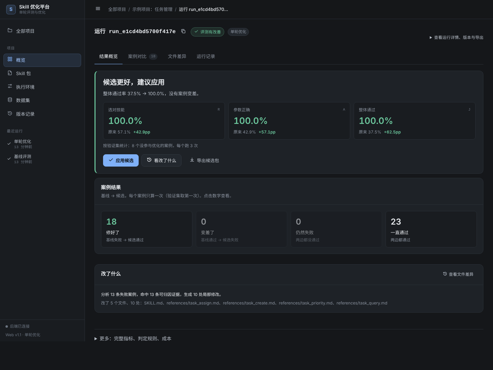
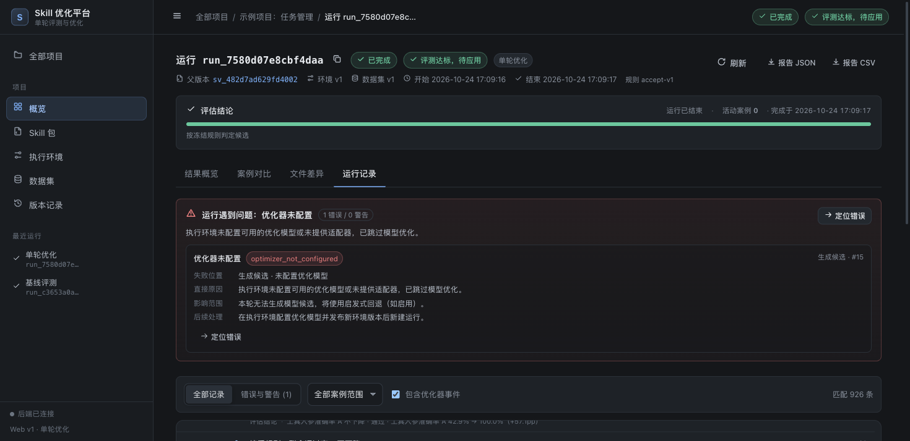
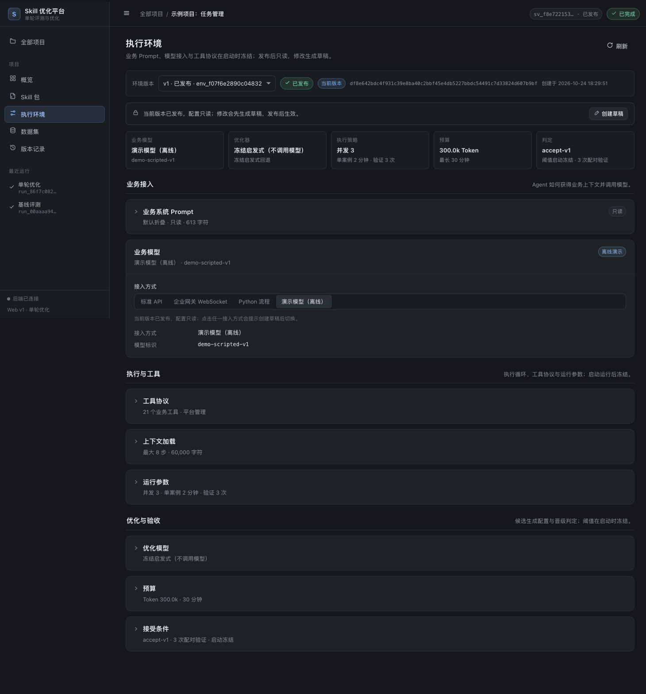

# 演示与验收路径

## 1. 准备

```bash
./start.sh --reset           # macOS/Linux：一键安装 + 重置示例 + 启动并打开浏览器
# 或分步：
bash scripts/setup.sh
.venv/bin/python -m app.seed --reset --with-optimize
./run.sh                     # http://127.0.0.1:8765
```

Windows 10/11 在安装 Python 3.11+ 后，双击 `start.bat`，或在 cmd 执行：

```bat
start.bat --reset
```

`seed --with-optimize` 会真实执行：导入 21 子技能 Skill 包 → 发布环境 → 发布 45 条数据集 →
跑基线 → 跑一次单轮优化（候选补丁、静态检查、3 次配对验证、接受规则判定）。

## 2. 预期结果

| 指标 | 基线（优化集） | 候选（优化集） | 基线（验证集×3） | 候选（验证集×3） |
| --- | --- | --- | --- | --- |
| 分发准确率 R | 83.33%（25/30） | **100%（30/30）** | 57.1%（12/21） | **100%（21/21）** |
| 工具入参准确率 A | 63.33%（19/30） | **100%（30/30）** | 42.9%（9/21） | **100%（21/21）** |
| 联合通过率 J | 60.61%（20/33） | **100%（33/33）** | 37.5%（9/24） | **100%（24/24）** |

候选改动 5 个文件、9 处局部修改，静态检查通过，`decision=accept`（“评测达标，待应用”）。
示例环境未接真实优化模型：运行日志会明确记录 `optimizer_not_configured`、
`fallback_started`，再使用冻结启发式回退——不会伪造模型输出。

## 3. 界面验证步骤

### 3.1 概览


1. 打开项目列表 → 示例项目。
2. 核对「配置完整性」四项（Skill 包/执行环境/数据集/兼容基线）与「最近指标」
   R 83.3%、A 63.3%、J 60.6%。
3. 主按钮为「单轮优化」；点击后侧栏展示版本快照、复用基线、候选 1、验证 3 次、
   预算与接受条件。

### 3.2 运行结果



1. 打开「最近运行」中的单轮优化（或项目概览 → 运行记录）。
2. 「结果概览」：R/A/J 基线↔候选与差值；接受规则逐项判定（R/A/J 不降、严格提高、
   critical 不回归、无基础设施错误、包完整性、验证完整、重复次数足够）。
3. 「案例对比」：41 行（33 优化集 + 8 验证集配对），回归优先；点开查看基线/候选
   实际路线、工具调用、参数差异（如 `$.status` 预期 `in_progress`、实际 `active`）。
4. 「文件差异」：5 个变更文件与统一 diff，附诊断/假设/风险与关联案例。
5. 「结论与应用」：显示「评测达标，待应用」→ 点击「应用候选」→ 确认父版本/变更文件数 →
   应用后项目当前版本指针切换（旧版本保留，可回滚）。

### 3.3 运行记录



1. 顶部问题摘要仅在有真实问题时出现；示例运行只有 1 条「优化器未配置」。
2. 点击「定位错误」：若被筛选隐藏会先清除筛选并提示「已切换到全部记录」，
   自动展开目标行并聚焦标题。
3. 筛选：全部记录 / 错误与警告、案例范围、是否包含优化器事件；显示匹配数量。
4. 点击日志行展开详情：原因/影响 → 请求与 messages → 原始返回 → 评分差异 → 技术详情；
   大内容按需从 trace-artifacts 加载。
5. 运行中的运行：滚动到底自动跟随；向上阅读暂停并显示「有 N 条新记录 / 回到最新」；
   断线显示「实时连接中断，正在重连」，恢复后自动补齐缺失事件且不重复。
6. 终态运行刷新/30 秒后仍可回放历史；历史缺失时显示「此运行未保存详细过程」，不补造。

### 3.4 配置页

- **Skill 包**：文件树 240px + 21 子技能；草稿编辑/发布/版本历史/导出 ZIP。
- **执行环境**：

  

  页面按「业务接入 / 执行与工具 / 优化与验收」三组组织，顶部先给出一行环境快照
  （业务模型、优化器、执行策略、预算、判定版本）。业务 Prompt 默认折叠（点击展开编辑/查看）；工具协议、
  上下文加载、运行参数、优化模型、预算、接受条件默认折叠，标题右侧直接显示关键摘要，
  展开后才是详细字段。数值参数统一为单行输入，高级参数（采样、超时、金额等）再折叠一层。
  发布后整页只读，内容以摘要形式展示；点击任一接入方式会提示创建草稿，
  确认后在草稿中切换（需保存/发布后生效）。
- **数据集**：45 案例表格、搜索/筛选/标签；案例侧栏展示 query、上下文、预期路线、
  预期工具与 fixture；导入弹窗先上传→展示统计/错误行/划分预览/覆盖→发布。
- **版本记录**：Skill/环境/数据集版本、父子关系、来源运行、比较、下载、设为当前（回滚）；
  未达标候选不能直接设为当前。

## 4. 不用浏览器也能验证

```bash
# 列出项目和最近运行
curl -s http://127.0.0.1:8765/api/v3/projects | python3 -m json.tool | head -40

# 看运行详情与逐项规则
RID=$(curl -s 'http://127.0.0.1:8765/api/v3/runs?project_id=...' | python3 -c 'import sys,json;print(json.load(sys.stdin)["items"][0]["id"])')
curl -s http://127.0.0.1:8765/api/v3/runs/$RID | python3 -m json.tool

# SSE（Ctrl+C 结束）
curl -N http://127.0.0.1:8765/api/v3/runs/$RID/events

# 报告下载
curl -s -OJ http://127.0.0.1:8765/api/v3/runs/$RID/report.json
```

## 5. 自动化验收

```bash
.venv/bin/python -m pytest -q     # 219 passed
```

A01–A20 的用例映射见 [VERIFICATION.md](VERIFICATION.md) 与
[REQUIREMENTS_TRACEABILITY.md](REQUIREMENTS_TRACEABILITY.md)。

## 6. 清理

```bash
pkill -f "python -m app.server"    # 停止服务
rm -rf data                        # 删除本地演示数据（谨慎）
```
